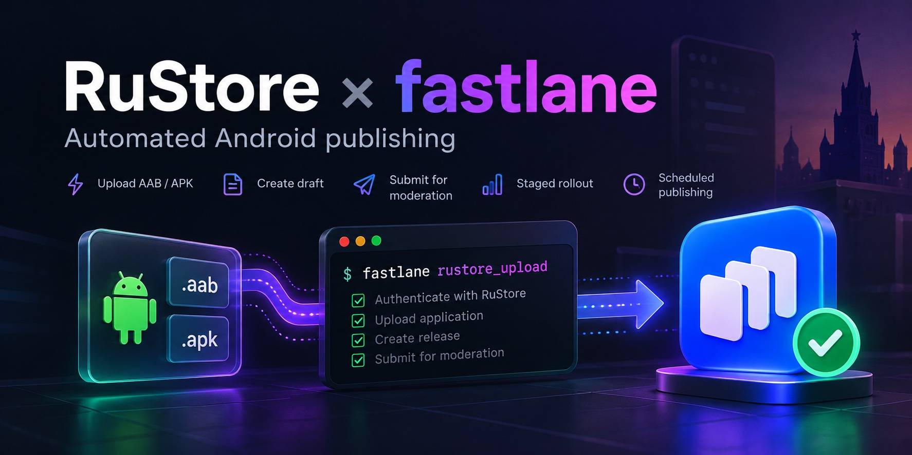

# RuStore fastlane plugin — publish Android apps to RuStore from CI

[](https://rubygems.org/gems/fastlane-plugin-rustore_publish)
[](https://rubygems.org/gems/fastlane-plugin-rustore_publish)
[](https://rubygems.org/gems/fastlane-plugin-rustore_publish)
[](LICENSE)



Fastlane plugin for publishing Android applications to [RuStore](https://rustore.ru) — the Russian app store — via the [RuStore Public API](https://www.rustore.ru/help/work-with-rustore-api/api-upload-publication-app). Uses the new `public-api-m.rustore.ru` domain with the Russian Trusted Root CA bundled, so nothing has to be installed on the runner.

Gem: `fastlane-plugin-rustore_publish` · Actions: `rustore_upload`, `rustore_check`

## Quick start

```sh
fastlane add_plugin rustore_publish
```

```ruby
# fastlane/Fastfile
lane :deploy_rustore do
  rustore_upload(
    package_name: "com.example.app",
    key_id:       ENV["RUSTORE_KEY_ID"],
    private_key:  ENV["RUSTORE_PRIVATE_KEY"],
    aab_path:     "app/build/outputs/bundle/release/app-release.aab",
    whats_new:    "Bug fixes and improvements"
  )
end
```

The key comes from RuStore Console → Company → API RuStore, see [Setup](#setup-rustore-api-credentials).

## По-русски

Плагин fastlane для публикации Android-приложений в RuStore из CI: создаёт черновик, загружает AAB и HMS APK, отправляет на модерацию. Работает через новый домен `public-api-m.rustore.ru`, на который RuStore переводит Public API; корневой сертификат Минцифры уже внутри плагина, ставить его на раннер не нужно. В логах CI видно, сколько шла отправка файла и сколько RuStore его проверял, а ошибки (таймаут, TLS, 504, новые чувствительные разрешения) приходят с подсказкой, что делать.

Для пробного прогона без выкладки есть `rustore_check`: получает токен и показывает последние версии приложения, ничего не загружая; 404 на списке версий считается успехом (ключ рабочий, версий через API пока нет).

Установка — `fastlane add_plugin rustore_publish`, пример — в [Quick start](#quick-start) выше. Вопросы и баги — в [Issues](https://github.com/gorban-dev/rustore-fastlane-plugin/issues), можно на русском.

## Features

- Upload **AAB** (Google/GMS, main artifact) and **APK** (Huawei/HMS, secondary) in a single version
- Full publish workflow: authenticate → create draft (with publication settings) → upload files → submit for moderation
- The pipeline always finishes immediately after submission — no waiting for moderation
- **GitLab CI** collapsible log sections (foldable blocks in Pipeline UI)
- Staged rollout support (`rollout_percentage`)
- Scheduled publishing (`DELAYED` + `release_date`)
- Auto-cleanup of existing drafts before creating a new one
- JWE token auto-refresh (900 s TTL)
- Works with the `public-api-m.rustore.ru` domain; the Russian Trusted Root CA is bundled, nothing to install on the runner
- CI-friendly upload logs: send time, a heartbeat while RuStore checks the file, response time, detected permissions and SDKs

## Requirements

- Fastlane ≥ 2.200.0
- Ruby ≥ 2.6
- At least **one active published version** must already exist in RuStore Console (API requirement)
- Outbound HTTPS to `public-api-m.rustore.ru:443`

### RuStore domain and certificate

RuStore moved the Public API from `public-api.rustore.ru` to `public-api-m.rustore.ru` ([announcement](https://www.rustore.ru/developer/blog/rustore-obnovlyaet-sertifikaty-i-domeny-chto-nuzhno-sdelat-razrabotchikam)). The new host is signed by the Russian Trusted Root CA, which is missing from the default OS and Ruby trust stores. The plugin ships that root (`lib/fastlane/plugin/rustore_publish/certs/russian_trusted_root_ca.crt`, from [Gosuslugi](https://www.gosuslugi.ru/crt), SHA-256 `D2:6D:2D:02:31:B7:C3:9F:92:CC:73:85:12:BA:54:10:35:19:E4:40:5D:68:B5:BD:70:3E:97:88:CA:8E:CF:31`) and trusts it in addition to the system roots, for plugin requests only.

---

## Installation

Add the plugin to your `Pluginfile`:

```ruby
# Pluginfile
gem "fastlane-plugin-rustore_publish"
```

Then run:

```sh
fastlane install_plugins
```

---

## Setup: RuStore API credentials

1. Log in to [RuStore Console](https://console.rustore.ru) with a **company owner** account
2. Go to **Company → API RuStore**
3. Click **Generate a key**, give it a name, select your app and required API methods
4. Download the **private key** (PEM file) — save it securely, RuStore does not store it

You will get two values:
- **Key ID** (`key_id`) — shown in the Console after generation
- **Private key** — the downloaded `.pem` file

---

## Parameters

| Parameter | Env var | Required | Default | Description |
|---|---|---|---|---|
| `key_id` | `RUSTORE_KEY_ID` | yes | — | API key ID from RuStore Console |
| `private_key_path` | `RUSTORE_PRIVATE_KEY_PATH` | one of two | — | Path to RSA private key PEM file |
| `private_key` | `RUSTORE_PRIVATE_KEY` | one of two | — | PEM content as string (for CI secrets) |
| `package_name` | `RUSTORE_PACKAGE_NAME` | yes | — | App package name, e.g. `com.example.app` |
| `aab_path` | `RUSTORE_AAB_PATH` | one of two | — | Path to AAB (Google/GMS — becomes main artifact) |
| `apk_path` | `RUSTORE_APK_PATH` | one of two | — | Path to APK (used when `aab_path` not set) |
| `hms_apk_path` | `RUSTORE_HMS_APK_PATH` | no | — | Path to Huawei/HMS APK (`servicesType=HMS, isMainApk=false`) |
| `whats_new` | `RUSTORE_WHATS_NEW` | no | — | Release notes shown to users (plain text, max 5000 chars) |
| `moder_info` | `RUSTORE_MODER_INFO` | no | — | Notes for the RuStore moderator, e.g. test credentials (max 180 chars) |
| `publish_type` | `RUSTORE_PUBLISH_TYPE` | no | `INSTANTLY` | `INSTANTLY` / `MANUAL` / `DELAYED` |
| `release_date` | `RUSTORE_RELEASE_DATE` | no | — | ISO 8601 datetime, only for `DELAYED` |
| `rollout_percentage` | `RUSTORE_ROLLOUT_PERCENTAGE` | no | — | Staged rollout: allowed values `5, 10, 25, 50, 75, 100` |
| `update_priority` | `RUSTORE_UPDATE_PRIORITY` | no | `0` | In-app update priority sent with the moderation request, `0`–`5` |
| `upload_timeout` | `RUSTORE_UPLOAD_TIMEOUT` | no | `900` | Seconds to wait for RuStore to answer an AAB/APK upload. RuStore checks the file (permissions, SDKs) before answering |

### Draft metadata (NEW — RuStore API v2)

RuStore's `create-draft-version` endpoint accepts additional fields beyond release notes. When unset, RuStore inherits each value from the previously active version. **`developer_contacts` may be required** if your RuStore Console developer contacts have not been filled in — a missing value here causes `API request failed [400]: Developer contacts are not filled in`.

| Parameter | Env var | Type | Description |
|---|---|---|---|
| `developer_contacts` | — | Hash | `{ email:, website:, vk_community: }` — at least one sub-key required |
| `app_name` | `RUSTORE_APP_NAME` | String | App display name, max 50 chars |
| `app_type` | `RUSTORE_APP_TYPE` | String | `GAMES` or `MAIN` |
| `categories` | — | Array&lt;String&gt; | Up to 2 categories, e.g. `["news", "education"]` |
| `age_legal` | `RUSTORE_AGE_LEGAL` | String | One of `0+`, `6+`, `12+`, `16+`, `18+` |
| `short_description` | `RUSTORE_SHORT_DESCRIPTION` | String | Brief description, max 80 chars |
| `full_description` | `RUSTORE_FULL_DESCRIPTION` | String | Full description, max 4000 chars |
| `price_value` | `RUSTORE_PRICE_VALUE` | String | Price in kopecks as digits, e.g. `"8799"` for 87.99 RUB |
| `seo_tag_ids` | — | Array&lt;Integer&gt; | Up to 5 search tag IDs |
| `faq` | — | Array&lt;Hash&gt; | Up to 10 items, each `{ question: ≤120 chars, answer: ≤500 chars }` |

Hash and Array parameters have no env-var binding — env vars carry strings only. If you need env-driven configuration, parse JSON yourself in your Fastfile:

```ruby
developer_contacts: JSON.parse(ENV.fetch("RUSTORE_DEVELOPER_CONTACTS"), symbolize_names: true)
```

**Example:**

```ruby
rustore_upload(
  package_name:       "com.example.app",
  key_id:             ENV["RUSTORE_KEY_ID"],
  private_key:        ENV["RUSTORE_PRIVATE_KEY"],
  aab_path:           "app/build/outputs/bundle/release/app-release.aab",

  # Draft metadata (v2)
  developer_contacts: {
    email:        "support@example.com",
    website:      "https://example.com",
    vk_community: "https://vk.com/example"
  },
  app_name:           "Example App",
  app_type:           "MAIN",
  categories:         ["news", "education"],
  age_legal:          "0+",
  short_description:  "Best example app",
  full_description:   "A longer description of what the app does and why people should install it...",
  faq: [
    { question: "How do I sign in?", answer: "Use your email and password." },
    { question: "Is it free?",       answer: "Yes." }
  ]
)
```

---

## Publish types

| `publish_type` | Behaviour |
|---|---|
| `INSTANTLY` | RuStore auto-publishes after moderation passes (default) |
| `DELAYED` | Scheduled publication via `release_date` in ISO 8601 |
| `MANUAL` | Moderation runs normally; publish manually from RuStore Console |

The pipeline finishes immediately after submitting for moderation for all three types.

---

## Usage examples

### Minimal — AAB only, INSTANTLY (default)

```ruby
# fastlane/Fastfile
lane :deploy_rustore do
  rustore_upload(
    package_name:     "com.example.app",
    key_id:           ENV["RUSTORE_KEY_ID"],
    private_key_path: "fastlane/rustore_private_key.pem",
    aab_path:         "app/build/outputs/bundle/release/app-release.aab"
  )
end
```

### AAB (GMS) + APK (HMS), staged rollout

```ruby
lane :deploy_rustore do
  rustore_upload(
    package_name:       "com.example.app",
    key_id:             ENV["RUSTORE_KEY_ID"],
    private_key:        ENV["RUSTORE_PRIVATE_KEY"],

    # Primary build — Google/GMS (AAB is always isMainApk)
    aab_path:           "app/build/outputs/bundle/gmsRelease/app-gms-release.aab",

    # Secondary build — Huawei/HMS (servicesType=HMS, isMainApk=false)
    hms_apk_path:       "app/build/outputs/apk/hmsRelease/app-hms-release.apk",

    publish_type:       "INSTANTLY",
    rollout_percentage: 25           # release to 25% of users first
  )
end
```

### Scheduled release

```ruby
lane :deploy_rustore_scheduled do
  rustore_upload(
    package_name: "com.example.app",
    key_id:       ENV["RUSTORE_KEY_ID"],
    private_key:  ENV["RUSTORE_PRIVATE_KEY"],
    aab_path:     lane_context[SharedValues::GRADLE_AAB_OUTPUT_PATH],
    publish_type: "DELAYED",
    release_date: "2025-03-01T10:00:00+03:00"  # Moscow time
  )
end
```

### Combined with Gradle build

```ruby
lane :build_and_deploy do
  gradle(task: "bundle",   flavor: "gms", build_type: "Release")
  gradle(task: "assemble", flavor: "hms", build_type: "Release")

  rustore_upload(
    package_name: "com.example.app",
    key_id:       ENV["RUSTORE_KEY_ID"],
    private_key:  ENV["RUSTORE_PRIVATE_KEY"],
    aab_path:     lane_context[SharedValues::GRADLE_AAB_OUTPUT_PATH],
    hms_apk_path: "app/build/outputs/apk/hmsRelease/app-hms-release.apk",
    publish_type: "INSTANTLY"
  )
end
```

---

## Check access (`rustore_check`)

A dry run for CI: gets a token, reads the first page of the app's versions and logs up to 5 latest of them. Creates, deletes and uploads nothing, and does not touch drafts. Use it to verify that the key in CI works and covers the package before a real release.

```ruby
lane :check_rustore do
  rustore_check(
    package_name: "com.example.app",
    key_id:       ENV["RUSTORE_KEY_ID"],
    private_key:  ENV["RUSTORE_PRIVATE_KEY"]  # or private_key_path:
  )
end
```

```
[RuStore] ✓ JWE token obtained
[RuStore] versionId=1234 versionName=2.4.0 versionCode=240 versionStatus=ACTIVE
[RuStore] versionId=1201 versionName=2.3.1 versionCode=231 versionStatus=PREVIOUS_ACTIVE
[RuStore] ✓ RuStore OK — ключ рабочий, версий: 2
```

| Result | Behaviour |
|---|---|
| Versions found | Logs up to 5 latest, returns the Array of version Hashes |
| Empty list | Success, returns `[]` |
| HTTP 404 on the version list | Success: the key is valid and covers the package, but RuStore opens the versions API only after the first publication from RuStore Console. Returns `[]` |
| `private_key` and `private_key_path` both missing or blank | Fails before any request: `RuStore: private_key или private_key_path не задан` |
| Auth error, 401/403, 5xx, network | Fails with a hint, like `rustore_upload` |

The 404 case is detected by HTTP status, not by message text.

---

## CI/CD integration

### GitLab CI

```yaml
# .gitlab-ci.yml

variables:
  RUSTORE_KEY_ID:      $RUSTORE_KEY_ID       # set in GitLab CI/CD → Variables
  RUSTORE_PRIVATE_KEY: $RUSTORE_PRIVATE_KEY  # set as "File" type variable — path to PEM

stages:
  - build
  - deploy

build:
  stage: build
  script:
    - bundle exec fastlane build_release
  artifacts:
    paths:
      - app/build/outputs/bundle/gmsRelease/
      - app/build/outputs/apk/hmsRelease/
    expire_in: 1 hour

deploy_rustore:
  stage: deploy
  needs: [build]
  script:
    - bundle exec fastlane deploy_rustore
  environment:
    name: production
  rules:
    - if: $CI_COMMIT_TAG =~ /^v\d+\.\d+\.\d+$/  # run only on version tags
```

```ruby
# fastlane/Fastfile
lane :deploy_rustore do
  rustore_upload(
    package_name:     "com.example.app",
    key_id:           ENV["RUSTORE_KEY_ID"],
    private_key_path: ENV["RUSTORE_PRIVATE_KEY"],  # "File" variable = path to PEM
    aab_path:         "app/build/outputs/bundle/gmsRelease/app-gms-release.aab",
    hms_apk_path:     "app/build/outputs/apk/hmsRelease/app-hms-release.apk",
    publish_type:     "INSTANTLY"
  )
end
```

**Checking the key without a release.** A manual job that runs `rustore_check`, e.g. after rotating the key:

```yaml
check_rustore:
  stage: deploy
  script:
    - bundle exec fastlane check_rustore
  rules:
    - when: manual
```

```ruby
# fastlane/Fastfile
lane :check_rustore do
  rustore_check(
    package_name:     "com.example.app",
    key_id:           ENV["RUSTORE_KEY_ID"],
    private_key_path: ENV["RUSTORE_PRIVATE_KEY"]
  )
end
```

**Storing the private key in GitLab:**

- Go to **Settings → CI/CD → Variables**
- Add `RUSTORE_KEY_ID` as a regular masked variable
- Add `RUSTORE_PRIVATE_KEY` as **type: File** — GitLab writes the PEM to a temp file and exports the path. Use `private_key_path: ENV["RUSTORE_PRIVATE_KEY"]`
- Alternatively, paste the PEM content as a masked variable and use `private_key: ENV["RUSTORE_PRIVATE_KEY"]`

**GitLab CI log output** (steps appear as collapsible sections):

```
▶ [RuStore] Step 1/5: Authentication              ← click to expand
▶ [RuStore] Step 2/5: Draft Management
▶ [RuStore] Step 3/5: Uploading AAB (GMS/main)
▶ [RuStore] Step 4/5: Uploading APK (HMS/secondary)
▶ [RuStore] Step 5/5: Submitting for moderation
[RuStore] ✓ All done! com.example.app versionId=12345 submitted to RuStore.
```

**Upload step output.** RuStore answers an upload only after it has checked the file, so the step logs when the file was sent and keeps a heartbeat until the answer arrives:

```
[RuStore] Sending app-release.aab (32.5 MB)
[RuStore] app-release.aab sent in 1.2s, waiting for RuStore to check it
[RuStore] Waiting for RuStore response: 60s / 900s
[RuStore] RuStore responded in 102s
[RuStore] Permissions detected by RuStore: android.permission.CAMERA, android.permission.ACCESS_FINE_LOCATION
[RuStore] SDKs detected by RuStore: analytics: com.google.firebase.analytics
[RuStore] ✓ AAB uploaded successfully
```

---

### GitHub Actions

```yaml
# .github/workflows/deploy-rustore.yml
name: Deploy to RuStore

on:
  push:
    tags:
      - 'v*'

jobs:
  deploy:
    runs-on: ubuntu-latest
    steps:
      - uses: actions/checkout@v4

      - uses: actions/setup-java@v4
        with:
          java-version: '17'
          distribution: 'temurin'

      - uses: ruby/setup-ruby@v1
        with:
          ruby-version: '3.2'
          bundler-cache: true

      - name: Build release
        run: bundle exec fastlane build_release

      - name: Deploy to RuStore
        env:
          RUSTORE_KEY_ID:      ${{ secrets.RUSTORE_KEY_ID }}
          RUSTORE_PRIVATE_KEY: ${{ secrets.RUSTORE_PRIVATE_KEY }}
        run: bundle exec fastlane deploy_rustore
```

```ruby
# fastlane/Fastfile
lane :deploy_rustore do
  rustore_upload(
    package_name: "com.example.app",
    key_id:       ENV["RUSTORE_KEY_ID"],
    private_key:  ENV["RUSTORE_PRIVATE_KEY"],  # PEM content from GitHub secret
    aab_path:     "app/build/outputs/bundle/gmsRelease/app-gms-release.aab",
    hms_apk_path: "app/build/outputs/apk/hmsRelease/app-hms-release.apk",
    publish_type: "INSTANTLY"
  )
end
```

**Storing secrets in GitHub:**

- Go to **Settings → Secrets and variables → Actions**
- Add `RUSTORE_KEY_ID` — the key ID string
- Add `RUSTORE_PRIVATE_KEY` — paste the full PEM content (including `-----BEGIN/END PRIVATE KEY-----` lines)

---

### Bitrise

```yaml
# bitrise.yml (relevant step)
- fastlane@3:
    inputs:
    - lane: deploy_rustore
    envs:
    - RUSTORE_KEY_ID: $RUSTORE_KEY_ID
    - RUSTORE_PRIVATE_KEY: $RUSTORE_PRIVATE_KEY
```

Add `RUSTORE_KEY_ID` and `RUSTORE_PRIVATE_KEY` as **Secret Environment Variables** in Bitrise **Secrets** tab.

---

## Multi-file versions

RuStore allows up to **1 AAB + 8 APK** (or 10 APK) files per version. The plugin supports the most common scenario:

```
Version
├── app-gms-release.aab   ← AAB, servicesType=Unknown, isMainApk=true (implicit)
└── app-hms-release.apk   ← APK, servicesType=HMS,     isMainApk=false
```

RuStore automatically serves the appropriate file to each user based on their device.

---

## Debugging

Enable verbose HTTP logging:

```sh
RUSTORE_DEBUG=1 bundle exec fastlane deploy_rustore
```

Run Fastlane with full verbose output:

```sh
bundle exec fastlane deploy_rustore --verbose
```

---

## Error reference

| Error | Cause | Fix |
|---|---|---|
| `Authentication failed: ...` | Wrong `key_id` or corrupted key | Check key in RuStore Console → API RuStore |
| `Failed to load RSA private key` | Invalid PEM format | Ensure the key includes `-----BEGIN/END PRIVATE KEY-----` |
| `API request failed [404]` | Package not found | Verify `package_name`; at least 1 active version must exist in RuStore Console |
| `API request failed [403]` | Key lacks permissions | Ensure the key has access to the required API methods for your app in Console |
| `version_code must be greater than current active` | Old build uploaded | Increment `versionCode` in `build.gradle` |
| `RuStore did not respond to the upload of ... within 900s` | RuStore is still checking the file | Rerun the lane (the draft is replaced); if it repeats, raise `upload_timeout` |
| `API request failed [504] ... non-JSON response` | RuStore gateway timeout | Failure on the RuStore side; rerun the lane |
| `TLS handshake with public-api-m.rustore.ru failed` | Certificate chain not trusted, often a TLS-inspecting proxy | Check the proxy and `SSL_CERT_FILE` on the runner |
| `Could not connect to public-api-m.rustore.ru` | DNS, proxy or firewall | Check network access from the runner to port 443 |
| `APK/AAB contains new sensitive permissions` | The build declares new sensitive permissions | Upload the file in RuStore Console and fill in the permission declaration |

---

## Development

```sh
git clone https://github.com/gorban-dev/rustore-fastlane-plugin
cd fastlane-plugin-rustore_publish
bundle install
bundle exec rspec                         # run tests
bundle exec rspec --format documentation  # verbose output
```

### Releasing

1. Bump `VERSION` in `lib/fastlane/plugin/rustore_publish/version.rb`, run `bundle install` to update `Gemfile.lock`, add a `CHANGELOG.md` entry, push to `main`.
2. Publish a GitHub release with tag `vX.Y.Z` matching `VERSION`.
3. The [`Publish gem`](.github/workflows/release.yml) workflow runs the specs, checks the tag against `VERSION` and pushes the gem to RubyGems via Trusted Publishing.

---

## License

MIT
